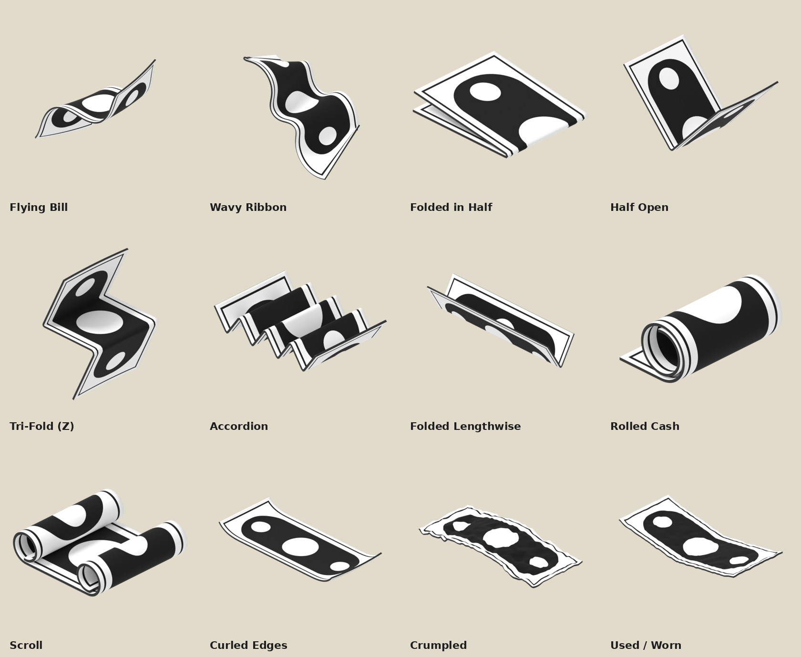
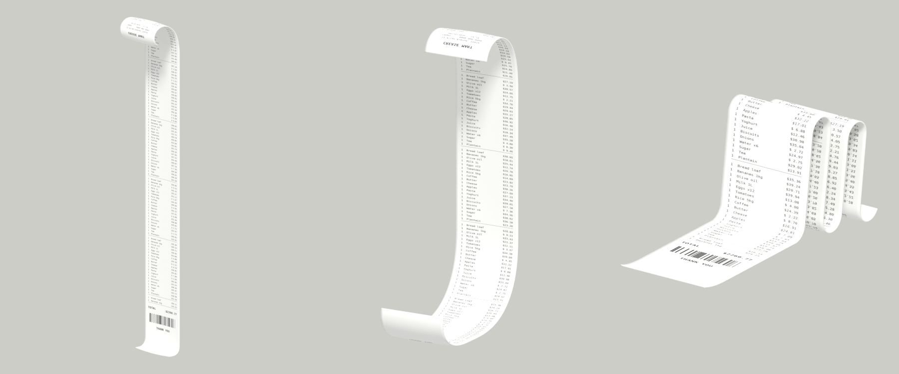
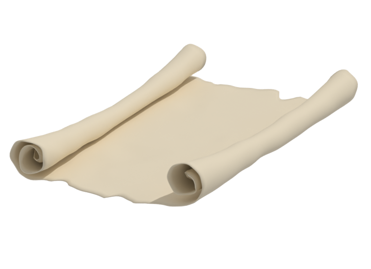

# Origa

**Shape paper inside Blender.** Turn any plane mesh into paper, then fold it, roll it, curl it, wave it, tear it or crumple it, all with simple sliders. Made with money in mind: flying bills, rolled cash and a whole rain of notes in one click.

### [⬇ Download Origa](https://github.com/iamkingsleey/Origa/releases/latest/download/origa.zip)

---

## What you can make

- **Money:** flying bills, folded notes, rolled cash, crumpled and worn bills, and Money Rain, a cloud of bills, each with its own shape
- **Folds:** in half, half open, tri-fold, accordion, folded lengthwise
- **Rolls & scrolls:** rolled sheets, two-ended scrolls, and parchment scrolls with uneven rolls and torn edges
- **Receipts:** standing receipts that curl over the top, S-curves, and long receipts piling up in arches
- **Paper in general:** curled edges, waves, twists, crumples, for posters, letters, notes and anything flat

## How it works

1. **Start with a plane.** Add a plane mesh, right-click it and choose **Convert To › Paper (Origa)**. Or add a ready-made sheet and pick a shape to start from: a flying bill, a fold, a scroll, a receipt.
2. **Shape it with sliders.** Move a slider and the paper changes instantly. Mix them freely, so a bill can be folded, curled and crumpled all at once.
3. **Put your design on it.** Load any image, like a bill, a receipt or a poster, and it wraps neatly through every fold and roll.
4. **Bring it to life.** Make bills flutter in the air, or animate any slider. Watch a note roll itself up, or a scroll unroll.

Every shape stays editable, so you can keep adjusting until it looks right. The paper bends like real paper; it never stretches.

Sizes are built in for the Dollar, Naira, Euro and Pound, plus A4, square and receipt paper.

## Install

1. [Download Origa](https://github.com/iamkingsleey/Origa/releases/latest/download/origa.zip). Keep it zipped.
2. Drag the file into Blender and click **Install**.
3. In the 3D view, press **N** and open the **Origa** tab.

Works with Blender 4.2 and newer.

Turn any plane mesh into paper with **right-click › Convert To › Paper (Origa)**. It keeps your plane's size. Or add a ready-made sheet from **Add › Mesh › Paper Sheet**.

## Made by

[Kingsley Mkpandiok](https://github.com/iamkingsleey), Multidisciplinary Designer
